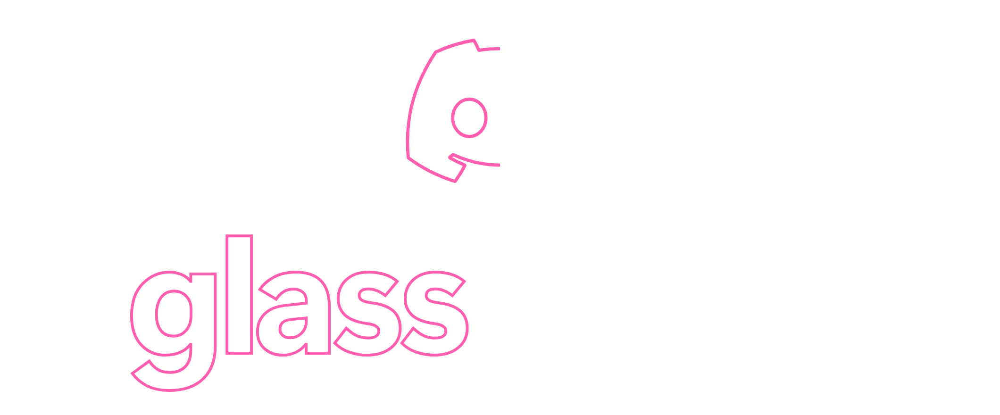
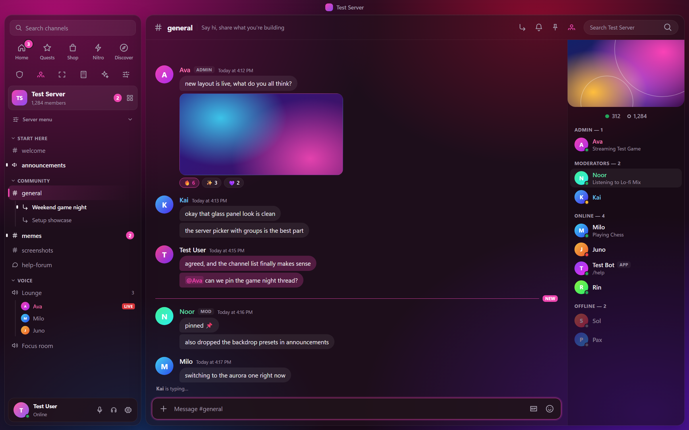
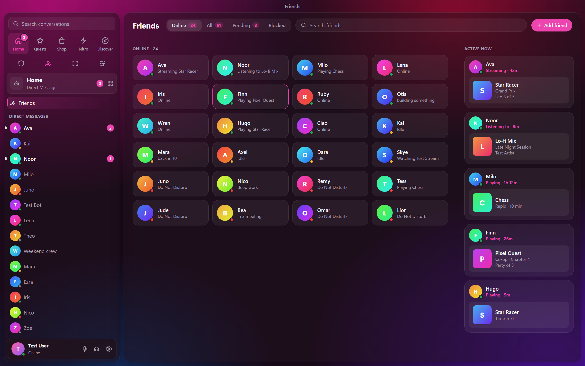
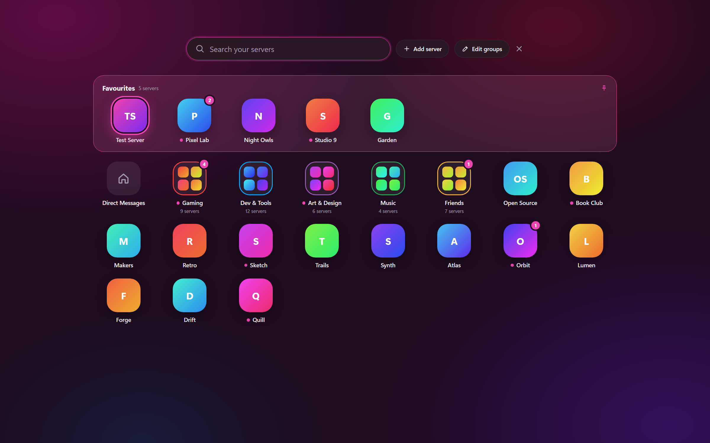

<p align="center">
  <picture>
    <source media="(prefers-color-scheme: dark)" srcset="assets/logo.png">
    <source media="(prefers-color-scheme: light)" srcset="assets/logo-on-light.png">
    
  </picture>
</p>

# Glasshouse

A full layout replacement for Discord, built as a [Vencord](https://vencord.dev) userplugin with a matching theme.

It swaps Discord's server rail and channel list for a single hub, adds a fullscreen server picker with your own groups, and restyles chat, friends and settings to match.



| Home and friends | Server picker |
|---|---|
|  |  |


*Preview images, drawn with sample data.*

## What it does

**Hub** (replaces the server rail and channel list)
- Search for channels and conversations
- Page buttons: Home, Quests, Shop, Nitro, Discover
- Custom channel list with collapsible categories, unread and mention counts, threads and forum posts, and people in voice channels
- Custom DM list
- Ping counts on Home and the server button, plus a strip of who pinged you
- Custom server menu, and a channel editor (create, rename, delete, reorder, drag between categories)
- Member finder with timeout, kick and ban
- Right-click opens Discord's own context menus
- Layouts: Left, Right, Top bar
- Calculator drawer with history

**Assistant**
- A private conversation in your DM list, with its own profile, name and picture
- Reads your servers, channels, DMs and Discord's search to catch you up, find things and draft replies
- Web search, picture attachments, and your servers' emojis, stickers and GIFs in the chat
- Point it at things with `##server`, `#channel` or `@person`, or open it as a floating window over the chat you are reading
- It never changes anything by itself. It can propose server changes (channels, categories, roles, name and description) as a card, and you approve each one
- It can speak in a server channel under its own name through a webhook: it drafts the message and you press Send
- It cannot post as you, message in DMs, or edit or delete messages
- Runs on Claude with your own Anthropic API key

**Server picker**
- Fullscreen animated grid of your servers
- Your own groups: create, rename, recolour, reorder, delete, pin open
- Drag servers between groups
- Join by invite, or create a server

**Theme**
- Frosted panels over a gradient or image backdrop, light and dark
- Message bubbles, restyled chat header, friends page, user and server settings
- Server banner above the member list

Everything is adjustable from the settings drawer (the sliders button in the hub).

## Install

**The easy way (Windows):** download [Glasshouse-Setup.cmd](https://github.com/itsnik-scrpt/glasshouse-vencord/releases/latest/download/Glasshouse-Setup.cmd) and double-click it. Windows may warn that the file came from the internet; choose to run it anyway.

It downloads the latest Glasshouse build (Vencord with Glasshouse inside), patches Discord using Vencord's own installer, and turns the plugin and theme on. After that Discord keeps Glasshouse up to date by itself. Run the same file again to reinstall or uninstall. It replaces a normal Vencord install; your Vencord settings and plugins are kept.

**From source:** you need Vencord built from source. See the [Vencord install guide](https://docs.vencord.dev/installing/). From your Vencord folder:

```sh
git clone https://github.com/itsnik-scrpt/glasshouse-vencord src/userplugins/glasshouse
pnpm build
```

Then:

1. Copy `src/userplugins/glasshouse/theme/Glasshouse.theme.css` into your Vencord themes folder (Discord → Settings → Vencord → Themes → Open Themes Folder).
2. Restart Discord.
3. In Settings → Vencord → Plugins, enable **Glasshouse** and **ThemeAttributes** (the second one lets your own message bubbles use the accent colour).
4. In Settings → Vencord → Themes, enable **Glasshouse**.

To update a source install: `git pull` inside `src/userplugins/glasshouse`, run `pnpm build`, and restart Discord. The theme file is refreshed automatically.

## Shortcuts

| Keys | Action |
|---|---|
| Ctrl+Alt+S | Focus the hub search |
| Ctrl+Alt+G | Open the server picker |
| Ctrl+Alt+D | Member finder |
| Ctrl+Alt+C | Calculator |
| Ctrl+Alt+A | Assistant |
| Ctrl+Alt+M | Show or hide the members pane |
| Ctrl+Alt+F | Focus mode (chat only) |

## Things to know before using it

- **It changes real servers.** The member finder's timeout, kick and ban, and the channel editor's create, rename, delete and move, act on the server immediately. Deletes, kicks and bans ask first; nothing else does.
- **The assistant only changes a server when you approve it.** Its proposals are checked against the real server and worded by the plugin, not by the assistant. Deletions and powerful role permissions are approved one at a time.
- **The assistant sends what it reads to Anthropic.** To answer a question it reads messages, including other people's and your DMs, and sends them to the Anthropic API under your key. The key is stored as plain text in Vencord's settings file.
- **It will break when Discord changes.** The hub reads Discord's page structure and class names, and drives some of Discord's own hidden controls. A Discord update can break parts of it until the plugin is updated. Turn off "Use this hub" in the settings drawer to get Discord's sidebar back.
- **Not covered by the hub's lists:** threads and forum posts you have not joined (open the channel to browse them), and drag-to-reorder servers.

## Licence

GPL-3.0-or-later, the same as Vencord. See [LICENSE](LICENSE).
