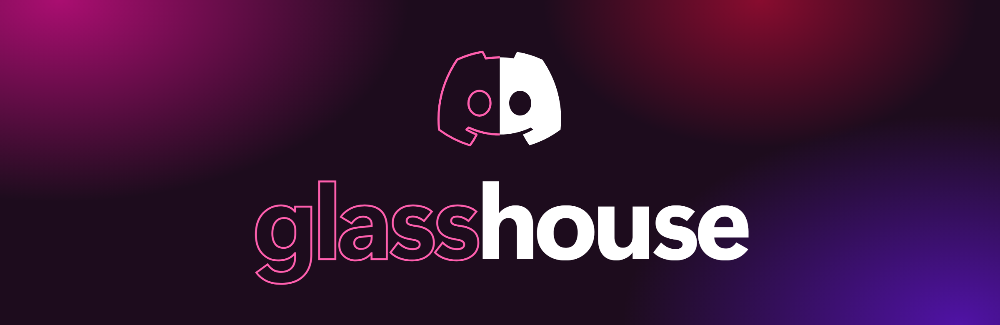
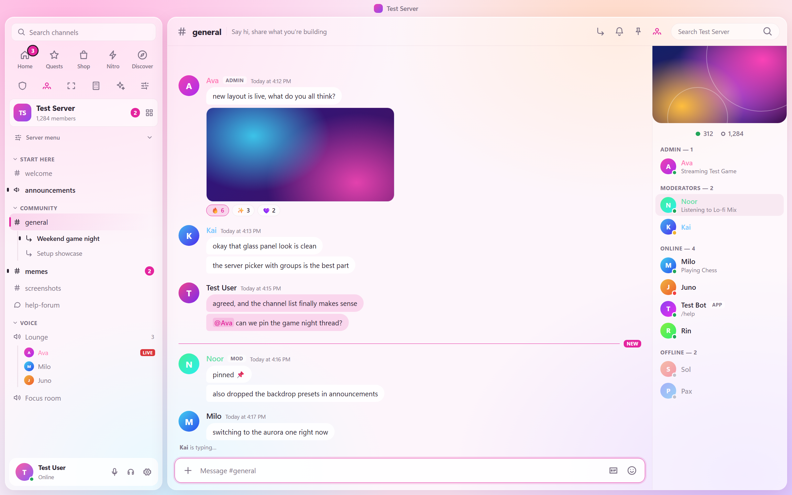

<p align="center"></p>

# Glasshouse

A full layout replacement for Discord, built as a [Vencord](https://vencord.dev) userplugin with a matching theme.

It swaps Discord's server rail and channel list for a single hub, adds a fullscreen server picker with your own groups, and restyles chat, friends and settings to match.


| Server picker | Light theme |
|---|---|
|  |  |

*Preview images, drawn with sample data.*

> **Unofficial.** This is not part of Vencord and would not be accepted there: it manipulates the page directly and redesigns Discord's UI. Client mods are against Discord's Terms of Service. Use it at your own risk.

## What it does

**Hub** (replaces the server rail and channel list)
- Search for channels and conversations
- Page buttons: Home, Quests, Shop, Nitro, Discover
- Custom channel list with collapsible categories, unread and mention counts, threads and forum posts, and people in voice channels
- Custom DM list
- Ping counts on Home and the server button, plus a strip of who pinged you
- Custom server menu, and a channel editor (create, rename, delete, reorder, drag between categories)
- Member finder with timeout, kick and ban
- Right-click opens Discord's own context menus
- Layouts: Left, Right, Top bar

**Server picker**
- Fullscreen animated grid of your servers
- Your own groups: create, rename, recolour, reorder, delete, pin open
- Drag servers between groups
- Join by invite, or create a server

**Theme**
- Frosted panels over a gradient or image backdrop, light and dark
- Message bubbles, restyled chat header, friends page, user and server settings
- Server banner above the member list

Everything is adjustable from the settings drawer (the sliders button in the hub).

## Install

You need Vencord **built from source**. The normal installer cannot load userplugins. See the [Vencord install guide](https://docs.vencord.dev/installing/).

From your Vencord folder:

```sh
git clone https://github.com/itsnik-scrpt/glasshouse-vencord src/userplugins/glasshouse
pnpm build
```

Then:

1. Copy `src/userplugins/glasshouse/theme/Glasshouse.theme.css` into your Vencord themes folder (Discord → Settings → Vencord → Themes → Open Themes Folder).
2. Restart Discord.
3. In Settings → Vencord → Plugins, enable **Glasshouse** and **ThemeAttributes** (the second one lets your own message bubbles use the accent colour).
4. In Settings → Vencord → Themes, enable **Glasshouse**.

To update: `git pull` inside `src/userplugins/glasshouse`, copy the theme file again, run `pnpm build`, and reload Discord with Ctrl+R.

## Shortcuts

| Keys | Action |
|---|---|
| Ctrl+Alt+S | Focus the hub search |
| Ctrl+Alt+G | Open the server picker |
| Ctrl+Alt+D | Member finder |
| Ctrl+Alt+M | Show or hide the members pane |
| Ctrl+Alt+F | Focus mode (chat only) |

## Things to know before using it

- **It changes real servers.** The member finder's timeout, kick and ban, and the channel editor's create, rename, delete and move, act on the server immediately. Deletes, kicks and bans ask first; nothing else does.
- **It will break when Discord changes.** The hub reads Discord's page structure and class names, and drives some of Discord's own hidden controls. A Discord update can break parts of it until the plugin is updated. Turn off "Use this hub" in the settings drawer to get Discord's sidebar back.
- **Not covered by the hub's lists:** threads and forum posts you have not joined (open the channel to browse them), and drag-to-reorder servers.

## Licence

GPL-3.0-or-later, the same as Vencord. See [LICENSE](LICENSE).
